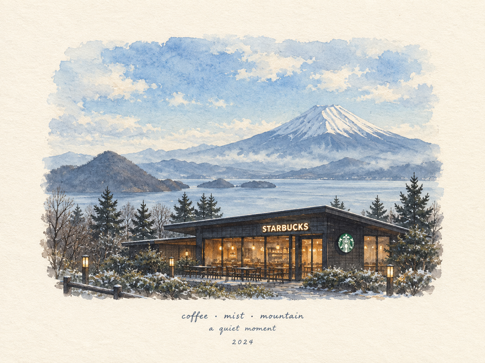
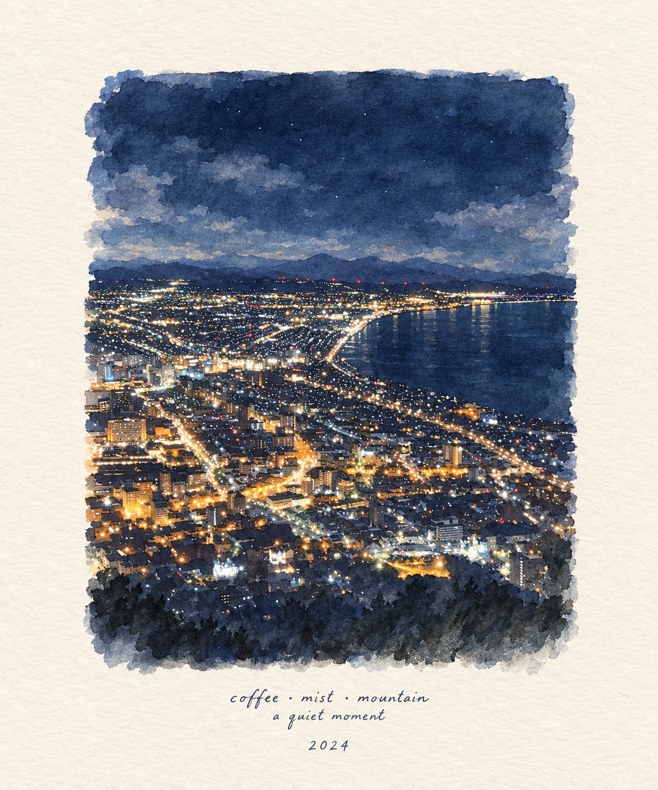
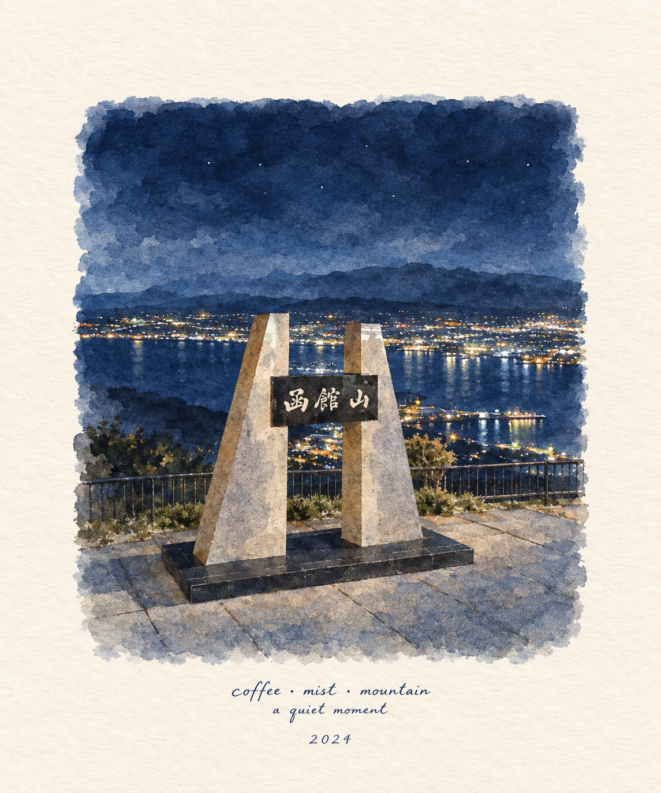
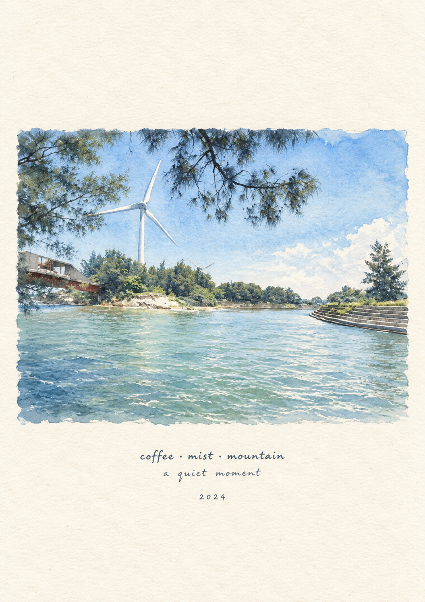

# Watercolor Travel Print

A small collection of AI-generated, hand-painted-style watercolor travel art
prints — each one turns a nighttime or daytime travel photo into a quiet,
minimal Japanese-inspired watercolor illustration on ivory textured paper,
signed with the same handwritten line: *"coffee · mist · mountain — a quiet
moment, 2024"*.

Repo: https://github.com/malilion/Watercolor-Travel.git

## Prompt

The full generation prompt (style, palette, composition, and typography
rules) used for these prints is documented in [Prompt.md](Prompt.md).

## Gallery

| | |
|---|---|
|  |  |
| Starbucks café with Mount Fuji rising behind it | Night cityscape along a coastal bay |
|  |  |
| Hakodateyama (函館山) night viewpoint overlooking the city | Daytime lakeside scene with a wind turbine and bridge |

## Style Notes

- Traditional Japanese-inspired watercolor on warm ivory textured paper
- Soft translucent washes, subtle pigment bleeding, visible paper grain
- Restrained winter palette: cobalt blue, icy blue, soft cyan, muted navy,
  pale gray, warm golden yellow
- Small, centered illustration surrounded by generous blank paper margin
- Understated, hand-lettered typography in dark blue-gray ink

## License

Code: [MIT](LICENSE). Original assets (art, models, audio, renders): [CC BY-NC 4.0](ASSETS_LICENSE.md).
